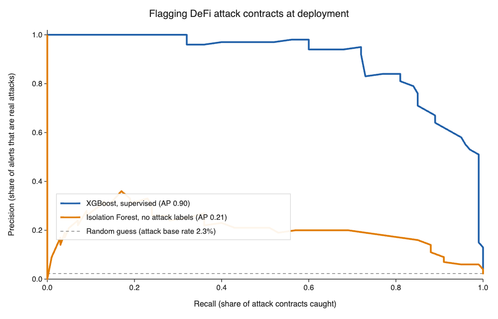
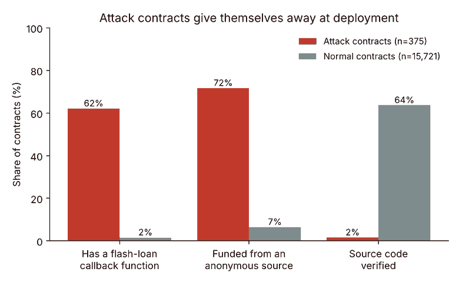

# Catching DeFi attack contracts at deployment: a LookAhead replication

Replication of the XGBoost detector from **LookAhead** (Ren et al., *Proceedings of the ACM on Software Engineering*, FSE 2025, [arXiv:2401.07261](https://arxiv.org/abs/2401.07261)), plus one experiment: can an **unsupervised Isolation Forest**, trained only on normal contracts and never shown a labelled attack, do the same job?

Part of my TKS Innovate Focus on AI × blockchain security. Build write-up (Medium, draft): coming soon. Learn article: [Can Unsupervised Anomaly Detection Flag Flash-Loan Oracle Attacks Before They Execute?](https://medium.com/@tevz.bijol/can-unsupervised-anomaly-detection-flag-flash-loan-oracle-attacks-before-they-execute-ff9bd0548b1a)

## Results (chronological split: oldest 80 % train, newest 20 % test)

Test set: 75 attack contracts, 3,145 normal contracts.

| Model | Precision | Recall | F1 | False-positive rate |
|---|---|---|---|---|
| LookAhead paper, XGBoost (Table 1) | 0.833 | 0.878 | 0.855 | 0.41 % |
| **My replication, XGBoost** | **0.771** | **0.853** | **0.810** | **0.60 %** |
| Isolation Forest, no attack labels (threshold = 99th percentile of normal scores, mean of 5 seeds) | 0.32 | 0.18 | — | 0.86 % |

- Area under the precision-recall curve: XGBoost 0.90, Isolation Forest 0.21 (random guessing = 0.02).
- ROC-AUC: XGBoost 0.996, Isolation Forest 0.925, so the unsupervised model does *rank* attacks as unusual, but normal contracts have a long tail of oddballs that drown the signal at any usable threshold.

## How to reproduce

1. Download `LookAhead_Dataset.zip` from the [LookAhead releases](https://github.com/zju-abclab/LookAhead/releases) and unzip it.
2. Put `attack_timestamp.csv` from the LookAhead repo's `dataset/` folder (stored with Git LFS) in the same folder.
3. `python3 extract_features.py` (standard library only) → `lookahead_features.csv` (375 attack, 15,721 normal contracts after the paper's filters: no token contracts, no ERC-1967 proxies).
4. `pip install pandas scikit-learn xgboost matplotlib tabulate`
5. `python3 build.py lookahead_features.csv` → `results.md`, `pr_curve.png`
6. `python3 checks.py` → seed and chain robustness checks (`robustness_checks.txt`)

## What I changed vs. the paper (and why it matters)

- **XGBoost only.** LookAhead stacks XGBoost with a transformer over decompiled code; I did not train the transformer. The paper's full model reaches F1 0.897 / FPR 0.16 %.
- **Precomputed features.** I used the authors' released features instead of decompiling contracts with Gigahorse.
- **Slightly fewer normal contracts** (15,721 vs. roughly 16,200 implied by the paper) because I keep only contracts with a known deployment block.
- **Chain imbalance.** All normal contracts are from Ethereum; 233 of 375 attacks are from BNB Chain. With Ethereum attacks only, XGBoost recall drops to 0.55 (precision 0.89), so part of the headline number may come from chain differences rather than attack behaviour.

## License / credit

Data and original method: Ren, He, Tu, Wu, Liu, Ren and Chen, LookAhead (FSE 2025). This repo only contains my replication code and results.

Tevž Bijol, TKS Innovate 2026–27
